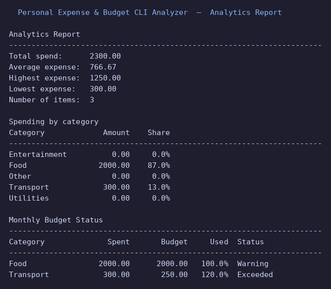

# Personal Expense & Budget CLI Analyzer

A command-line personal finance app that records daily expenses, organises
spending by category, enforces monthly category budget limits, and prints
formatted terminal analytics reports.

**IT Simplera — Python Development, Week 1, Task 1 (1 of 8)**
Team Lead: Zafar Ullah · Difficulty: Beginner · Python 3.11+

## Features

1. **Add Expense** — date (YYYY-MM-DD), category, positive amount,
   description. Invalid input is rejected and re-prompted, never a crash.
2. **View & Filter** — all expenses in a formatted table; filter by
   category, by date range, or by both.
3. **Budget Alerts** — monthly caps per category with status tags:
   **Safe** (under 80%), **Warning** (80%–100%), **Exceeded** (over 100%).
4. **Analytics Report** — total spend, average expense, highest and
   lowest transaction, and percentage share per category.

Data is kept in memory for the session (list of dicts, set of categories,
tuple for the summary). There is no database and no third-party
dependency — only the Python standard library.

## Folder structure

```text
week1-expense-cli/
├── src/
│   ├── __init__.py
│   ├── main.py          # Interactive CLI menu & user routing
│   ├── analytics.py     # Expense storage, budget checks & summary
│   └── validators.py    # Date, amount and category validation
├── tests/
│   └── test_analytics.py
├── .gitignore
├── requirements.txt     # Standard library only, no external packages
├── LICENSE
└── README.md
```

## Setup and run

```bash
python -m venv venv
source venv/bin/activate        # Windows: venv\Scripts\activate
python src/main.py
```

Requires Python 3.11 or newer. No packages to install.

## Menu

```text
  1. Add Expense
  2. View All Expenses
  3. Filter Expenses (by Category / Date Range)
  4. Set Monthly Budget
  5. Analytics Report
  6. Exit
```

Valid categories: Food, Transport, Utilities, Entertainment, Other
(input is case-insensitive — `food` becomes `Food`).

## Sample terminal session



Real output from a run (add two expenses, view them, set a Food budget,
print the analytics report, exit):

```text
Welcome! Your expenses are kept in memory for this session.

==================================================
  Personal Expense & Budget CLI Analyzer
==================================================
  1. Add Expense
  2. View All Expenses
  3. Filter Expenses (by Category / Date Range)
  4. Set Monthly Budget
  5. Analytics Report
  6. Exit
--------------------------------------------------
Choose an option (1-6): 1

Add Expense
Date (YYYY-MM-DD): 2026-11-17
Category (Entertainment, Food, Other, Transport, Utilities): Food
Amount: 1250
Description: Team lunch

Added expense #1: 2026-11-17 | Food | 1250.00 | Team lunch

Choose an option (1-6): 1

Add Expense
Date (YYYY-MM-DD): 2026-11-11
Category (Entertainment, Food, Other, Transport, Utilities): Transport
Amount: 300
Description: Bus fare

Added expense #2: 2026-11-11 | Transport | 300.00 | Bus fare

Choose an option (1-6): 2

ID    Date         Category             Amount  Description
----------------------------------------------------------------------
1     2026-11-17   Food                1250.00  Team lunch
2     2026-11-11   Transport            300.00  Bus fare
----------------------------------------------------------------------
Total: 1550.00  (2 expenses)

Choose an option (1-6): 4

Set Monthly Budget
Category (Entertainment, Food, Other, Transport, Utilities): Food
Monthly budget cap: 2000

Budget set: Food = 2000.00 per month.

Choose an option (1-6): 5

Analytics Report
----------------------------------------------------------------------
Total spend:      1550.00
Average expense:  775.00
Highest expense:  1250.00
Lowest expense:   300.00
Number of items:  2

Spending by category
Category             Amount    Share
----------------------------------------------------------------------
Entertainment          0.00     0.0%
Food                1250.00    80.6%
Other                  0.00     0.0%
Transport            300.00    19.4%
Utilities              0.00     0.0%

Monthly Budget Status
----------------------------------------------------------------------
Category              Spent       Budget     Used  Status
----------------------------------------------------------------------
Food                1250.00      2000.00    62.5%  Safe

Choose an option (1-6): 6

Goodbye! Thanks for using the Expense Analyzer.
```

Bad input is handled in the same session, for example a wrong date
(`17/11/2026`) or a negative amount (`-50`) prints a plain message and
asks again instead of crashing.

## Tests

12 assert-based tests covering totals, empty-list safety, budget
warning thresholds (80% and 100% boundaries), and validation
rejections. Run from the project root:

```bash
python tests/test_analytics.py
```

Expected output: `12 passed, 0 failed, 12 total.`

The same tests also run under pytest (`python -m pytest tests/`).

## Quality checks (verified)

- **PEP 8:** `pycodestyle --max-line-length=79 src/ tests/` — 0 issues.
- **Zero crashes:** invalid text, negative amounts, bad dates, empty
  lists, bad menu choices, and end-of-input are all handled without
  tracebacks.
- **Performance:** summary + category totals + percentages for 1,000
  in-memory records runs in under 1 ms (requirement: under 50 ms).
- **Modular:** validation (`validators.py`), analytics (`analytics.py`)
  and the menu (`main.py`) are separate; functions take explicit
  parameters and return plain values — no global mutable state.

## Notes

- Amounts are plain numbers (no currency symbol), matching the task
  specification's example records.
- Option 3 covers the specification's "Filter by Category" menu item
  plus the functional requirement to filter by date range (category,
  date range, or both).
- Expenses and budgets exist only while the program runs; closing the
  app clears them.

## License

Copyright (c) 2026 Muhammad Hashir. All Rights Reserved. This
repository is public for viewing only.
